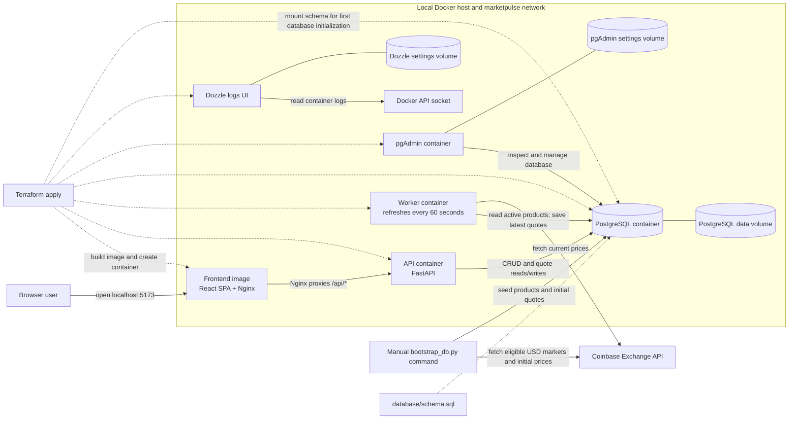

# MarketPulse

These documents describe MarketPulse, a Coinbase crypto price tracker built as a sequence of components. Follow the numbered delivery order; later specs depend on the contracts and components established earlier. Testing is cross-cutting and should begin with the first component.

## Current solution architecture

The diagram shows the solution defined by the repository. The Docker containers, images, volumes, and network were removed, so the runtime is currently stopped. Terraform can recreate the container stack and initialize the schema on a fresh PostgreSQL volume; the bootstrap command separately seeds Coinbase markets and initial prices.

Terraform creates the containers in dependency order: PostgreSQL first, then the API, worker, and pgAdmin after PostgreSQL is healthy; the frontend waits for the API, and Dozzle waits for the services. The PostgreSQL image runs the mounted schema file when initializing an empty data volume. Run `database/scripts/bootstrap_db.py` after PostgreSQL starts to seed markets and their initial quotes. `terraform destroy` also deletes the Terraform-managed data volumes.

## Design exploration

The finalized design is [Option B: React + TypeScript, FastAPI, and PostgreSQL](Specs/DESIGN_TECHNOLOGY_OPTIONS.md), using a component-based modular monolith and layered backend architecture. A single Terraform-managed Docker worker refreshes active product prices from Coinbase every 60 seconds and persists latest quotes to PostgreSQL. Follow the [Technical Implementation Guide](Specs/TECHNICAL_IMPLEMENTATION_GUIDE.md) for the complete step-by-step build plan and current implementation status.

## Documents and build order

| Step | Spec | Component to build | Dependency / outcome |
|---|---|---|---|
| 00 | [Project overview](Specs/00_PROJECT_OVERVIEW.md) | Requirements and shared constraints | Agree on goals, assumptions, and scope |
| 01 | [Technical foundation](Specs/01_TECHNICAL_FOUNDATION.md) | Runtime, configuration, persistence conventions, API health/errors | Runnable application skeleton |
| 02 | [Coinbase integration](Specs/02_COINBASE_PRICE_INTEGRATION.md) | Coinbase catalog and price provider adapters | Product discovery and exact quote retrieval |
| 03 | [Product CRUD](Specs/03_PRODUCT_CRUD.md) | Product persistence, first-run 10-market bootstrap, CRUD | Users maintain the application-owned tracked list |
| 04 | [Price refresh](Specs/04_PRICE_REFRESH.md) | Scheduled and manual refresh service | Prices remain current with per-market status |
| 05 | [Dashboard UI](Specs/05_DASHBOARD_UI.md) | Product management and price display workflows | End-to-end user experience |
| 06 | [Docker and local development](Specs/06_DOCKER_LOCAL_DEV.md) | Image, Terraform-managed containers, durable volume, health checks | Repeatable local deployment |
| 07 | [Test strategy](Specs/07_TEST_STRATEGY.md) | Unit, integration, UI, and Docker acceptance coverage | Add and run tests alongside each preceding step |

## Recommended implementation sequence

1. Read spec 00 and record stack/API decisions.
2. Build and document the application skeleton, configuration, database schema setup, and common API conventions (01).
3. Implement and mock Coinbase catalog and price adapters; verify official endpoint behavior (02).
4. Implement product schema/CRUD and bootstrap the initial 10 eligible markets through the provider interface (03).
5. Add the refresh service, scheduler, freshness state, and manual refresh endpoint (04).
6. Build the dashboard, catalog picker, and CRUD/refresh interactions (05).
7. Containerize the complete app with Terraform and verify persistent data and health behavior (06).

Start testing in step 01. Each feature spec defines tests for its own behavior; spec 07 consolidates the complete acceptance matrix. Default tests must use fake Coinbase responses and must not depend on live network access.

## Initial database setup

The PostgreSQL schema, Terraform-managed Docker containers, and Coinbase bootstrap are documented in [`database/`](database/README.md). Start the complete stack, including the built React frontend, with `terraform -chdir=terraform init` and `terraform -chdir=terraform apply`. Terraform initializes the schema when PostgreSQL creates a new data volume. Install root Python dependencies with `.venv/bin/python -m pip install -r requirements.txt`, then seed products with `.venv/bin/python database/scripts/bootstrap_db.py` (export `DATABASE_URL` first if it differs from the local default). The app is at [http://localhost:5173](http://localhost:5173), API docs at [http://localhost:8000/docs](http://localhost:8000/docs), pgAdmin at [http://localhost:5050](http://localhost:5050), and Dozzle logs at [http://localhost:8080](http://localhost:8080). For Vite development mode, see [STARTUP.md](STARTUP.md).
