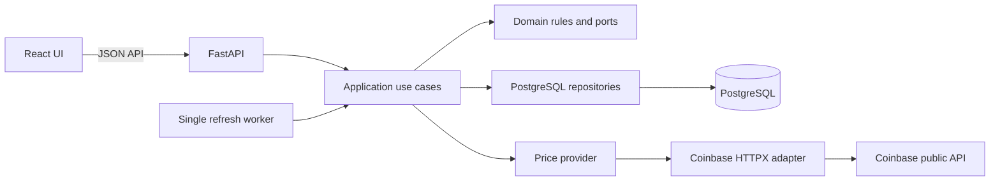

# MarketPulse design and technology

**Decision:** Option 2 (Option B) is selected.  
**Status:** Approved for the first release.

## Selected stack

| Area | Choice | Use |
|---|---|---|
| UI | React, TypeScript, Vite | Dashboard and product workflows. |
| API | Python, FastAPI, Pydantic | CRUD, price data, refresh command, and health endpoints. |
| Database | PostgreSQL | Tracked products and their latest saved quotes. |
| Persistence | SQLAlchemy 2, psycopg | PostgreSQL database access; schema setup is defined in `database/schema.sql`. |
| Coinbase client | HTTPX | Public product ticker requests. |
| Local runtime | Terraform-managed Docker containers | PostgreSQL, API, UI, and one refresh worker. |

Keep the first release as a small modular monolith. Do not add a queue, microservices, authentication, or a frontend state framework until a product requirement needs one. The first release is single-user and local-first.

## Component design

The browser requests application data from FastAPI. The backend reads and writes PostgreSQL. One server-side worker fetches Coinbase prices for active tracked products and saves the latest successful quotes. Browser polling reads saved values from FastAPI; it never calls Coinbase.

## Layer responsibilities

- **UI:** Render product and quote state; call typed API functions. Keep prices as strings and format without binary floating-point arithmetic.
- **Presentation:** FastAPI routes and Pydantic request/response schemas. Validate HTTP input and map application results to responses. No SQL or Coinbase logic.
- **Application:** CRUD and refresh use cases. Coordinate repositories and provider interfaces.
- **Domain:** Product/quote rules, decimal-safe values, freshness states, and ports. No framework or I/O dependencies.
- **Infrastructure:** SQLAlchemy repositories, Coinbase HTTPX adapter, scheduler, and configuration.

Follow dependency inversion: domain/application code depends on interfaces, while API, database, and Coinbase integrations implement or call those interfaces. Keep each component focused on one responsibility and pass dependencies in through the composition root.

## Data and price behavior

- `tracked_products` stores the application-owned market list.
- `latest_quotes` stores one current price and retrieval/error state per product.
- Store money in PostgreSQL `NUMERIC`, Python `Decimal`, and API/browser decimal strings.
- A failed Coinbase request records its attempt and safe error category while preserving the last successful price.
- The UI shows `Current`, `Stale`, `Unavailable`, or `Not fetched`; never imply a failed request is a zero price.
- Product deletion removes the current quote through the database foreign key. Historical prices are out of scope.

## First-release boundaries

Authentication and multi-user ownership are deferred while the app remains local and trusted. Before public deployment, add identity, authorization, TLS, and secret management. Production scaling, hosted telemetry, historical prices, trading, wallets, and portfolio features are also out of scope for the first release.

For endpoint details, acceptance criteria, and delivery status, see the [technical implementation guide](TECHNICAL_IMPLEMENTATION_GUIDE.md) and [feature specs](00_PROJECT_OVERVIEW.md).
